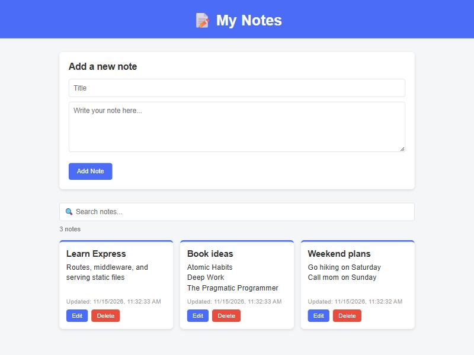

# 📝 Notes App

A simple full stack notes app where you can create, edit, delete and search notes.
Built with **Node.js + Express** on the backend and plain **HTML, CSS and JavaScript** on the frontend.

This is **Day 1** of my daily project challenge, where I build one project every day, from simple to advanced.



## Features

- Add a note with a title and content
- Edit and delete notes
- Search notes by title or content (live search as you type)
- Latest edited notes are shown first
- Notes are saved in a JSON file, so they stay after restarting the server
- Basic validation (title is required) on both frontend and backend

## Tech Stack

| Part     | Tech                         |
| -------- | ---------------------------- |
| Frontend | HTML, CSS, Vanilla JavaScript |
| Backend  | Node.js, Express             |
| Storage  | JSON file (`data/notes.json`) |

## Project Structure

```
notes-app/
├── public/          # frontend files
│   ├── index.html
│   ├── style.css
│   └── app.js
├── data/            # notes.json is created here automatically
├── server.js        # express server and API routes
└── package.json
```

## How to Run

1. Clone the repo
   ```bash
   git clone https://github.com/gopichandreddy007/notes-app.git
   cd notes-app
   ```
2. Install packages
   ```bash
   npm install
   ```
3. Start the server
   ```bash
   npm start
   ```
4. Open **http://localhost:3000** in your browser

Use `npm run dev` to restart the server automatically when you change a file.

## API Endpoints

| Method | Endpoint                 | Description                 |
| ------ | ------------------------ | --------------------------- |
| GET    | `/api/notes`             | Get all notes               |
| GET    | `/api/notes?search=word` | Search notes                |
| GET    | `/api/notes/:id`         | Get one note                |
| POST   | `/api/notes`             | Create a note               |
| PUT    | `/api/notes/:id`         | Update a note               |
| DELETE | `/api/notes/:id`         | Delete a note               |

Example request body for POST / PUT:

```json
{
  "title": "Shopping list",
  "content": "Milk, eggs, bread"
}
```

## What I Learned

- Building a REST API with Express
- Reading and writing JSON files with the `fs` module
- Using `fetch` to call an API from the frontend
- Updating the page with DOM methods
- Using `textContent` instead of `innerHTML` so user input can't inject HTML

## Future Ideas

- Add tags or colors for notes
- Pin important notes to the top
- Use a real database like MongoDB or SQLite
